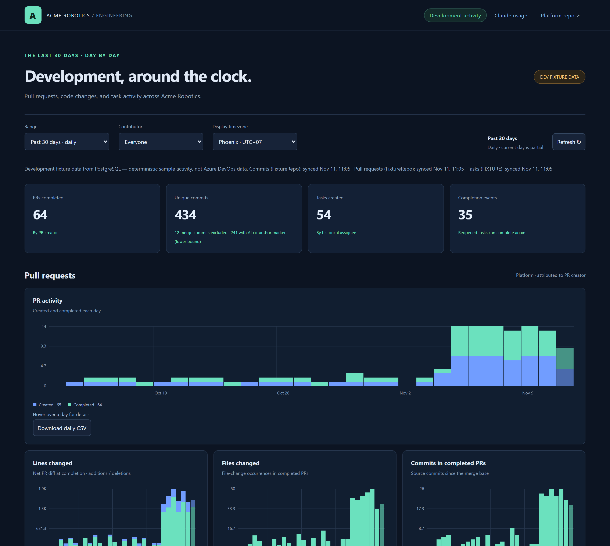
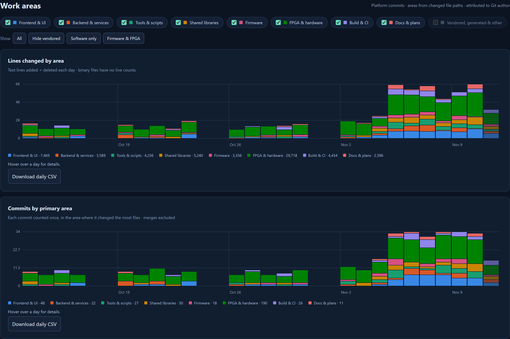
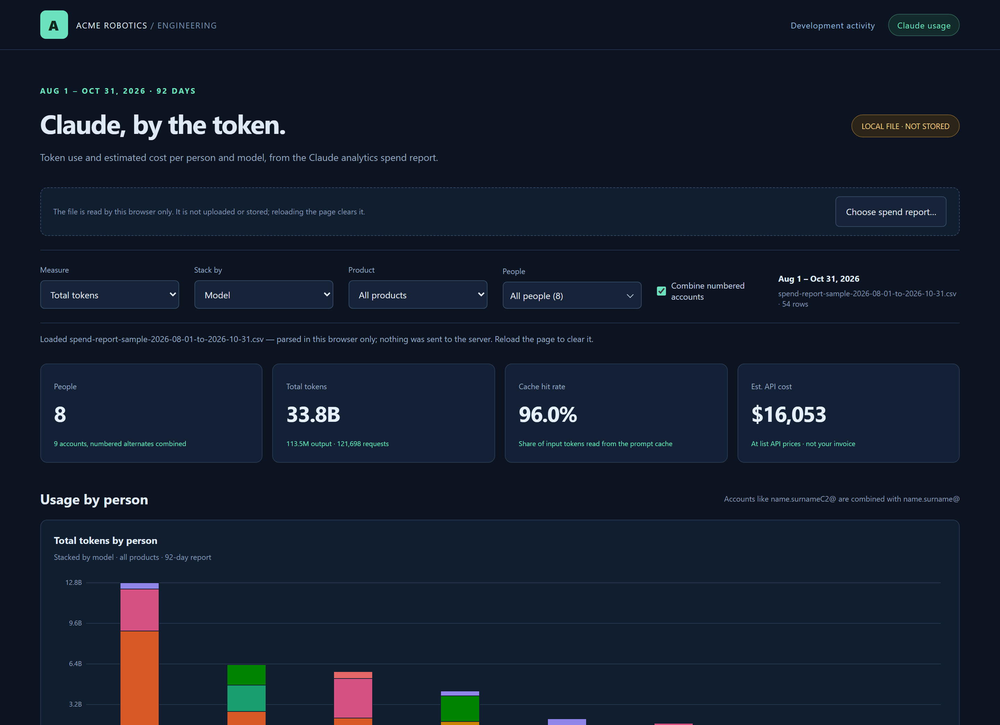
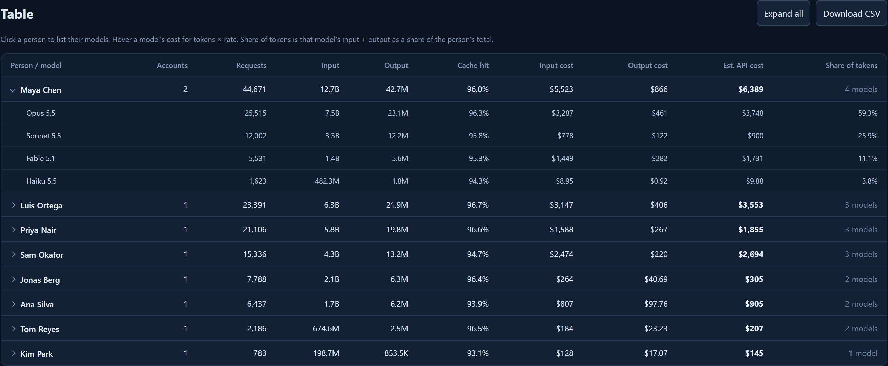
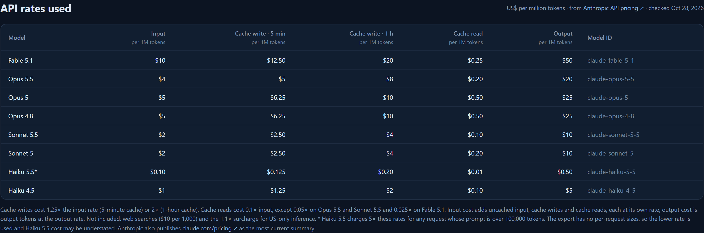
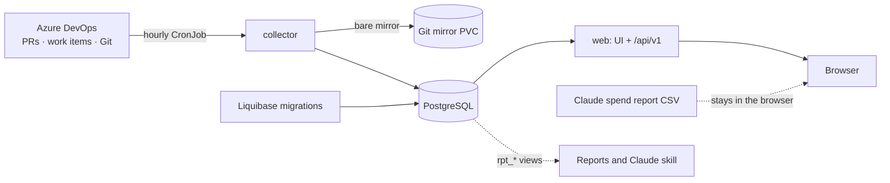

# Engineering Activity

**See how your team actually builds software: every pull request, commit and task, hour by hour,
across every branch. Then see exactly what Claude is costing you, person by person.**



Engineering Activity is a small, self-hosted dashboard for teams on **Azure DevOps**. A collector
pulls pull requests, commits and work items into PostgreSQL every hour; a fast Go web app turns
them into charts you can slice by person, group, time range and code area. A second page turns
the **Claude Team "spend report" export** into a per-person, per-model breakdown of tokens and
API-equivalent cost, entirely in your browser.

> The screenshots show built-in sample data for a made-up company, "Acme Robotics". No real
> people or usage appear anywhere in this repository.

## Why you might want it

- **Around-the-clock activity, honestly counted.** 168 hourly buckets for the last week (nights
  and weekends included), daily for 30 days, weekly for 12 or 24 months. Commits are
  deduplicated across every branch; merges are excluded; missing statistics stay *unknown*,
  never silently zero.
- **Who did what, without double counting.** Filter by person or by group (say, "FPGA engineers").
  Several Azure identities and Git emails fold into one person.
- **Where the work goes.** Editable path rules tag every changed file into areas such as
  Frontend, Backend, Firmware, FPGA or Build & CI, so you can watch the code mix shift.
- **AI adoption, measured carefully.** Commits carrying AI co-author markers (Claude, Copilot,
  Codex and others) are counted and clearly labeled as a lower bound.
- **Claude usage without an Enterprise API.** Drop in the CSV from Claude analytics and get a
  stacked chart per person, cache-efficiency breakdowns, and a cost table that shows its work.
- **Built to be queried.** Stable `rpt_*` SQL views and an included Claude skill let an agent
  build long-range reports from the same data.

## A quick tour

**Work areas.** Toggle areas on and off; both charts restack and rescale.



**Claude, by the token.** Export the spend report from Claude analytics and drop it on the page.
Numbered alternate accounts (`jane.doeC2@…`) roll up into one person, and you can hide anyone
before taking a screenshot.



**Cost you can check.** Expand anyone to see each model's input and output cost and share of
their tokens. Hover a cost to see `tokens × rate` for every part of it.



Every rate comes from Anthropic's public pricing page, listed on the page with a link:



The spend report is parsed in the browser and never sent to the server.

## Try it in two minutes

Requires Docker with Linux containers.

```bash
cp .env.example .env          # then set POSTGRES_PASSWORD (letters and digits)
docker compose up --build -d web
```

Open <http://127.0.0.1:8080>. Liquibase builds the schema and loads deterministic sample data
(labeled **DEV FIXTURE DATA**): five people, a week of hourly activity and two years of history.
For the Claude page, generate a fictional spend report and drop it on <http://127.0.0.1:8080/claude.html>:

```bash
node scripts/sample-spend-report.mjs
```

No database at all? `DEMO_MODE=true` serves an in-memory preview ([frontend container](docs/frontend-container.md)).

---

## How it works



| Component | What it does |
| --- | --- |
| `cmd/dashboard` (`web` image) | Embedded UI, `/api/v1/*` read APIs, health checks, Prometheus `/metrics` on a separate port |
| `cmd/collector` (`collector` image) | Run-to-completion collector (hourly CronJob or backfill) using Microsoft's Azure DevOps Go SDK, plus a bare Git mirror for exact line statistics |
| `db/changelog` (`migrations` image) | Liquibase owns all schema, reporting views and the explicit-only `@dev-seed` sample data |
| `helm/engineering-activity` | Helm chart: web, collector CronJob, backfill Job, migrations, optional bundled PostgreSQL, ingress, ServiceMonitor |
| `.claude/skills/` | Skills that help Claude Code work on this repo and report from its data |

### Counting rules (summary)

- **Time:** UTC storage; day and week buckets align to the display timezone. Periods not yet
  collected, or before history collection began, are faded rather than shown as quiet.
- **Commits:** unique per repository across all branches, at committer time, credited to the Git
  author mapped to an Azure identity by email. Merges are excluded from counts and churn.
- **Pull requests:** created/completed counts by creator; lines, files and commits come from the
  completion snapshot (merge base → source).
- **Tasks:** created at creation; *completed* on entry into your configured completion states from
  outside them (a reopened task can complete again), credited to the assignee in that revision.

Full definitions: [architecture](docs/architecture.md) and the [reporting contract](docs/reporting.md).

## Deploy it yourself

You need a Kubernetes cluster (1.27+), a container registry, and an Azure DevOps PAT with
**Code: Read** and **Work Items: Read**.

1. **Build and push the three images** (`web`, `collector`, `migrations`) from the `Dockerfile`,
   tagged with the commit. Never use `latest`.
2. **Create the Secret** with the database password, PAT and dashboard login (see
   [deployment](docs/deployment.md)).
3. **Write your values file.** Start from [`deploy/values.example.yaml`](deploy/values.example.yaml):
   organization, project, repositories, completion states, image tags, storage and ingress.
4. **Install** with Helm, or point Argo CD at `helm/engineering-activity` with your values file
   kept in your own GitOps repository:

   ```bash
   helm upgrade --install activity helm/engineering-activity \
     -n activity --create-namespace -f my-values.yaml
   ```

5. **Backfill history** (optional): a one-off Job collects up to 24 months.

The chart runs migrations before the web app and collector start, scrapes cleanly with the
Prometheus Operator, and keeps the database and Git mirror volumes when uninstalled.
Details, including Argo CD notes and backups: [deployment](docs/deployment.md).

## Configuration

| Variable | Used by | Purpose |
| --- | --- | --- |
| `DATABASE_URL` | web, collector | PostgreSQL URL (required unless `DEMO_MODE=true`) |
| `AZURE_DEVOPS_ORG`, `AZURE_DEVOPS_PROJECT` | collector | **Required.** Organization and project to collect |
| `AZURE_DEVOPS_REPOSITORIES` | collector | **Required.** Comma-separated repository names |
| `AZURE_DEVOPS_PAT` \| `AZURE_DEVOPS_TOKEN_COMMAND` \| `AZURE_DEVOPS_BEARER_TOKEN` | collector | Exactly one: a PAT in the cluster, or a token command (for example `az account get-access-token …`) locally |
| `COMPLETION_STATES` | collector | Default `ready for qa test build,ready to test,closed`; validated against the live workflow |
| `WORK_ITEM_TYPES` | collector | Default `Task` |
| `GIT_MIRROR_DIR` | collector | `data/mirrors` (`/data/mirrors` in the image) |
| `SYNC_OVERLAP`, `SYNC_BOOTSTRAP`, `RECONCILE_EVERY`, `RECONCILE_WINDOW` | collector | `2h`, `168h`, `24h`, `168h` |
| `COLLECTOR_CONCURRENCY` | collector | `4` |
| `BRAND_ORGANIZATION`, `BRAND_TEAM`, `BRAND_SCOPE` | web | Header and footer text (defaults: Engineering / Activity / Your repositories) |
| `BRAND_LINK_LABEL`, `BRAND_LINK_URL` | web | Optional header link, for example to your repository |
| `LISTEN_ADDR` / `METRICS_ADDR` | web | `127.0.0.1:8080` / unset (container: `0.0.0.0:9090`) |
| `DASHBOARD_USERNAME` / `DASHBOARD_PASSWORD` | web | HTTP Basic auth; put HTTPS in front. `ALLOW_UNAUTHENTICATED=true` only on loopback or behind an authenticating proxy |
| `DEMO_MODE` | web | `true` serves in-memory sample data without a database |

Collector flags: `--mode scheduled|reconcile|backfill|window`, `--months N` / `--days N` /
`--from`, `--to`, `--sources commits,pull_requests,tasks`, `--deadline`.

## Development

```bash
go vet ./... && go test ./...                     # TEST_DATABASE_URL enables PostgreSQL integration tests
./scripts/test-compose.ps1 -BrowserTests          # isolated Compose + Liquibase + Playwright acceptance
./scripts/test-frontend-container.ps1 -BrowserTests
```

More: [local development](docs/local-development.md), [browser tests](docs/browser-tests.md),
[refreshing the README screenshots](docs/screenshots.md).

**Working with an AI agent?** Start with [`CLAUDE.md`](CLAUDE.md). The skills in
[`.claude/skills/`](.claude/skills) cover running the app, deploying it, and building reports
from the data.

## Known limits

- Branches deleted or force-pushed before the first collection, and deleted work items, cannot be recovered.
- Work items converted to another type are no longer collected as that type.
- Git authors whose email does not match an Azure identity appear as `(Git)` until an alias is added ([reporting](docs/reporting.md)).
- Activity credited to a person does not distinguish their own work from agents using their account.
- The Claude cost is an estimate at public API list prices, not your invoice; Team plans export
  $0 spend for seat usage.
